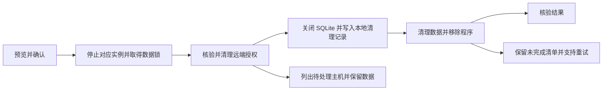

# 03 · Imon 完整卸载技术方案

适用范围为桌面安装包和独立 Web 发布包。两端复用同一个卸载实现，按当前用户和明确选择的数据目录执行。本文中的命令、界面和状态是待实现契约。交付形态沿用 [02 技术方案](02-v0.1.0-desktop-and-collection.md)。

## 1. 用户入口与卸载范围

| 交付物 | 入口 | 完成条件 |
| --- | --- | --- |
| macOS 桌面版 | 应用菜单「Imon → 完整卸载」。退出后也可运行应用包中的 `imon-desktop uninstall` | 窗口已退出，选择的数据已清理，当前 `Imon.app` 已移除 |
| Linux 桌面版 | 桌面菜单「完整卸载」展示终端入口，用户运行 `imon-desktop uninstall` | 当前用户选择的数据已清理，发行版包管理器确认 `imon-desktop` 已清除 |
| Windows 桌面版 | Windows「已安装的应用 → Imon → 卸载」，选择「完整卸载」 | 当前用户选择的数据和专用 WebView2 配置已清理，NSIS 已移除程序、快捷方式及卸载记录 |
| 独立 Web 版 | 发布包中的 `imon uninstall`，Windows 为 `imon.exe uninstall` | 对应监听已停止，选择的数据和当前发布包内的启动程序已移除 |

macOS 的 Finder 废纸篓操作只处理所选文件。完整卸载走应用菜单或维护命令。如果已经拖走桌面应用，可以从废纸篓恢复应用再走这个入口，也可以用同版本或更新版本的 Web 程序运行 `imon uninstall --data-only`。

桌面和 Web 默认共享监控状态。确认时逐项列出选中的数据目录和这次移除的程序，并提示「删除共享数据后，仍安装的另一版也会失去这些连接、设置和历史」。两版都安装时，需要分别移除两版的程序。用户主动配置的启动项需要先通过原服务管理器停止并移除。用户级卸载覆盖以下内容。

- 默认搜索当前账号的 `imon` 和历史 `infra-monitor` 两个目录，即使只配置过其中一个。macOS 基目录为 `~/Library/Application Support`。Linux 采用绝对的 `XDG_DATA_HOME`，否则用 `~/.local/share`。Windows 使用 `%LOCALAPPDATA%`。
- 指定 `--data-dir` 时只处理列出的目录。参数可重复，适用于自定义路径和有记录的调试实例。两种安装版本没有集中登记过的自定义目录由用户指明。
- 清理确认归属 Imon 的 SQLite、WAL 等附属文件、程序生成的数据库回滚副本、更新缓存、实例记录和锁。路径规则见第 4 节。
- 用户自己管理的 SSH 私钥、`known_hosts`、kubeconfig、手动导出的外部备份、其他账号的数据和目录里的非 Imon 文件保持原位。远端只移除 Imon 安装的辅助程序、授权及已记录的暂存脚本。用户自行配置的 SSH、sudo 与 Kubernetes RBAC 由原配置者管理。
- Web 浏览器里的旧会话在服务退出后失效。卸载结果显示原地址和会话 Cookie 名 `imon_<PORT>`，用户可在访问过面板的浏览器中按名称清理。使用独立解包目录的用户可移除该目录中的说明、校验文件和下载的归档。

现有依据为 [数据目录选择与实例锁](../../internal/appdata/appdata.go)、[Web 入口](../../cmd/imon/main.go)、[桌面入口](../../cmd/imon-desktop/main.go)和 [Windows 安装器](../../packaging/desktop/installer-windows.nsi)。

## 2. 交互与命令

桌面确认窗口复用一次性原生界面。默认选中当前账号存在的新旧数据目录。「添加目录」用于选择曾用的自定义目录。路径和共享数据提示放在同一处。已有桌面运行时可提供当前库的主机数，其他目录显示「执行时核验」。取消直接关闭窗口。遇到忙碌实例或路径异常时，窗口列出需要处理的对象。

```text
┌─ 完整卸载 Imon ───────────────────────────┐
│ 程序       <APP_PATH>                     │
│ 数据目录   <DATA_DIR_1> [添加目录]        │
│            <DATA_DIR_2>                   │
│ 远端授权   <HOST_COUNT> 台待检查          │
│ 删除共享数据也会清空另一版的绑定和历史。  │
│                        [取消] [完整卸载]  │
└───────────────────────────────────────────┘
```

Web 使用同一个发布程序进入维护模式。交互式执行显示清单并等待明确确认。非交互执行要求 `--yes`，仍须输出清单和终态。`--dry-run` 仅检查路径和实例状态，可以把远端状态列为「执行时核验」。预览阶段没有 SQLite 写入、进程退出或远端调用。

```sh
./imon uninstall --dry-run
./imon uninstall
./imon uninstall --data-dir '<DATA_DIR>' --data-only
```

`--data-only` 保留可执行文件和安装记录，仍按完整流程检查远端授权。Windows 用同样的子命令和参数。退出码约定为 `0` 已核验清理或目标已不存在，`2` 参数错误或缺少确认，`3` 运行实例、远端准备或权限问题导致提交前中止，`4` 本地清理待继续。Windows Web 的进程外删除启动成功时也先返回 `4`，由同一终端的清理进程输出最终删除结果。终端显示失败阶段、涉及的已选路径或主机显示名及重试方式。

## 3. 共用执行顺序



1. **确认执行对象。** 对默认目录、显式目录和程序路径做归属检查，生成有序清单。对每个选中的数据目录，要求它当前可用，或能用第 4 节的清理记录继续。校验程序移除所需的权限和平台入口。发现版本、路径或文件身份变化时重新预览。
2. **释放并取得实例锁。** 桌面由当前窗口完成确认并退出共享运行时，随后以维护模式继续，也允许用户从终端退出后直接执行。Web 通过第 5 节停止匹配的新版本实例。旧实例和自管服务按实际启动渠道停止。`internal/appdata` 对全部选中目录按规范化路径顺序非阻塞加锁，任何一个目录仍有运行实例就退出。已无对应程序和数据的范围按已清理处理。
3. **先清远端。** 维护模式只打开所选数据库和现有 SSH 授权工具。它复用 `internal/control/firewall.go` 中单机卸载、暂存脚本清理和结果核验的逻辑，提取出独立于 HTTP 队列的入口，跳过采集、通知和更新。盘点覆盖现有主机绑定及各连接版本仍待清理的暂存记录。使用现有 SSH 并发上限 4 和单机维护任务的 3 分钟超时。一台机器只有在终态为 `success` 且 `cleanup_confirmed=true` 时才算完成。两个库里的重复主机允许重复核验，主机别名和 IP 不作为已经清理的证据。
4. **保留可重试信息。** 单机清理采用辅助程序卸载语义，保留绑定直到本地提交。主机离线、权限不足、SSH 身份变化或历史暂存记录无法联系时，列出具体主机，保留本地数据库和程序。权限不足时用户可通过现有主机操作提供独立管理员凭据，或确认上传脚本后执行和核验，再重试完整卸载。历史版本已经删除的绑定可能缺少远端线索，只能用已知主机重新绑定或由其管理员检查。
5. **清理本地并验证。** 所有选中目录的远端核验完成后关闭数据库，再进入第 4 节的本地提交。清理完成后移除当前程序或适用的安装包，验证每个约定路径及安装项。程序是最后移除的对象，以便中途失败时重复运行。手动导出的备份可以用现有 `--backup` 和 `--restore` 恢复本地状态。恢复数据库后如需原来的远端能力，须重新安装已撤销的授权。

共用核心拟落在 `internal/uninstall/`，数据发现和实例互斥继续归属 `internal/appdata/`，远端操作归属 `internal/control/`。退出和平台动作分别接入 `cmd/imon/`、`cmd/imon-desktop/` 及 `packaging/desktop/`。[现有运行时关闭顺序](../../internal/panelruntime/runtime.go) · [现有辅助程序维护](../../internal/control/firewall.go) · [备份与恢复](../guides/backup-and-restore.md)

## 4. 数据归属与中断恢复

- 增加只读发现入口，逐个检查两个默认候选和用户指定路径。现有 `appdata.Open` 会建目录和文件，因此维护发现单独实现。执行前复用现有属主和访问策略，拒绝根目录、嵌套的选中目录、指向目录之外的链接以及程序位于自定义数据根内的布局。以文件身份去重。使用只读数据库检查确认 SQLite 格式和 Imon 表结构，支持现有备份恢复逻辑可辨认的旧库版本。缺少主库且没有可信清理记录的自定义目录交给用户确认具体文件。
- 清理清单包括 `state.sqlite3`、`-wal`、`-shm`、`-journal`、`instance.lock`、`web-instance.json`，程序生成的 `state.sqlite3.pre-migrate-v*-*.bak` 和 `state.sqlite3.pre-restore.pre-migrate-v*-*.bak`，以及归属得到验证的 `.update-state-*/state.sqlite3` 和 `updates/<VERSION>/` 内的已知发布资产与下载暂存文件。匹配项在锁内复核实际文件身份与类型。程序旁的更新候选和回退文件只在有记录指向当前程序时纳入。遇到未知文件时显示保留清单，最后只移除清空的目录。
- 增加私有 `uninstall.pending`。锁定所有选中目录后，在开始删除任何数据库或缓存前写入本批清单。记录相对路径、文件身份和已完成阶段，不保存绑定与凭据。如果准备清单失败，撤回本次新建的记录并保留数据库。正常启动发现该记录时提示用对应卸载命令继续，避免重建仍在清理的库。
- 旧版退出是提交前提。新版本启动与最终移除锁文件使用相同的短锁。在 Unix 上对已校验的数据父目录句柄加 `flock`，在 Windows 上使用按用户 SID 与规范化父目录标识命名的系统互斥量，设置当前 SID 和 SYSTEM 可访问。正常启动在获得短锁后再判定默认目录回退、创建数据目录和非阻塞尝试实例锁。卸载持有短锁完成数据库关闭后的最终文件核验、释放 Windows 文件句柄、移除锁、最后移除清理记录和空目录。远端操作在短锁之外执行。遇到锁竞争退出并保留可重试记录。
- 删除任一数据文件后进入不可回退的本地清理阶段。单项删除失败时保留记录供下次继续。重试核对清单后跳过已不存在的文件，处理仍存在且身份一致的文件。替换过的文件作为冲突上报，锁或记录只在剩余清单为空时清理。

[Unix 数据访问约束](../../internal/appdata/appdata_unix.go) · [Windows 数据访问约束](../../internal/appdata/appdata_windows.go) · [数据库校验和回滚文件](../../internal/store/backup_restore.go) · [更新替换流程](../../cmd/imon/restart.go)

## 5. 实例退出和安装包适配

### Web 实例

Web 每次启动监听成功后，在对应数据目录原子写入私有的 `web-instance.json`，内容为本次实际监听地址、随机实例标识和至少 256 位的随机凭据。退出前在实例锁内清除属于本实例的记录。卸载 CLI 验证记录归属，使用禁用代理和重定向的 HTTP 客户端直连该 IPv4 回环端口。现有监听上的内部 `POST /_imon/local/shutdown` 校验回环来源、精确的 Host、实例标识和独立凭据。请求关闭和提交版本更新共用同一个退出状态，先获得退出权的一方完成，另一方收到冲突。服务先响应，再进入现有 `server.Shutdown` 和运行时关闭流程。

CLI 等待最多 30 秒取得实例锁。地址或凭据失效、旧实例没有记录时，显示按启动终端或原服务管理器停止的指引。PID 仅可用于显示诊断信息。完成核验以锁和该服务的实例标识为依据。用户配置的守护服务可能自动重启，需要先退出并移除对应配置。[现有 Web 监听和优雅关闭](../../cmd/imon/main.go)

### 平台移除

| 平台 | 接线及移除方式 |
| --- | --- |
| macOS | 菜单确认后关闭桌面运行时，以同一程序的维护模式完成清理。根据可执行文件所在的 `.app` 确认归属，校验 `org.inframonitor.desktop` 与 `Contents/MacOS/imon-desktop`，再移除该应用包。分发沿用 ZIP。 |
| Linux | 以安装用户身份清理当前用户数据。对 `.deb` 安装的桌面版，在有终端的情况下由 `sudo apt-get purge imon-desktop` 移除包及注册项，先预检认证和包归属。解包运行的 Web 版移除经过校验的自身文件。 |
| Windows 桌面 | NSIS 的完整卸载选项先调用共享维护入口清理当前用户的数据和 Imon 专用 WebView2 profile。进程退出并完成核验后，再由 NSIS 现有卸载段删除程序及安装注册项。 |
| Windows Web | 数据提交后用随系统提供的 PowerShell 启动一次性清理进程。执行固定内存脚本，通过管道传入结构化的程序路径和进程身份。清理进程在启动程序退出前验证进程和文件身份、取得并持有进程句柄，然后等待该句柄结束，再删除并检查指定可执行文件。结果输出到原终端。若工作进程启动失败、程序被占用或身份变化，保留程序并给出重试原因。 |

Windows Web 的清理进程不需要额外服务或永久安装。Windows 桌面的专用配置目录按当前打包使用的 WebView2 profile 规则验证。Linux 桌面以打包后的图形会话确认 WebKitGTK 产生的数据归属，单独的 Imon 路径才纳入清理。macOS 已使用非持久 WebView 数据存储。[桌面发布包](../../packaging/desktop/README.md) · [Windows 安装脚本](../../packaging/desktop/installer-windows.nsi) · [macOS WebView 配置](../../internal/desktop/cocoa_darwin.m)

## 6. 待验证的交付条件

| 场景 | 预期证据 |
| --- | --- |
| 旧目录、新目录、自定义目录、两个默认目录同时存在 | 预览列出精确范围。选中目录的受管文件移除，未选目录及外部凭据仍在。新启动使用空状态 |
| Web 正在运行、旧版实例无实例记录、并行尝试更新 | 新实例只关闭正确的监听并释放锁。旧实例显示对应的停止操作。更新和卸载之间有单一终态 |
| 远端权限正常、离线、需要管理员、残留暂存脚本 | 清理已核验才删除本地状态。离线及不明结果能列出主机并保留连接。补齐权限后可重复执行 |
| 数据目录包含用户文件、路径别名或被替换 | 用户文件和未选目录仍存在。重复路径只处理一次。文件身份变化时保留冲突路径 |
| 在写清单、删除数据库和删除程序之间注入中断 | 重新运行能继续。其他新版本进程不会打开半清理的库。状态输出能区分重试、已清理和程序移除待完成 |
| macOS ZIP、Linux DEB、Windows NSIS 及便携 Web 包 | 在对应原生环境安装与卸载，核对进程、包和注册项、数据路径。Windows Web 必须验证异步退出与二进制最终确实消失，包括目录含空格、普通用户和占用失败 |

开发者初评为 **72/100**。主要阻力是 Windows 可执行文件释放时序、多目录清理中断和远端结果不明确。优化时将 Windows 文件删除交给一次性进程，冻结本地提交清单与锁时序，并将远端失败截在本地提交之前。复评为 **63/100**。共用逻辑具备实施条件。Windows Web 进程外移除、各平台包和 WebView 专用目录仍需要原生环境验证。分数表示实现难度，验收结果以第 6 节的实际记录为准。
